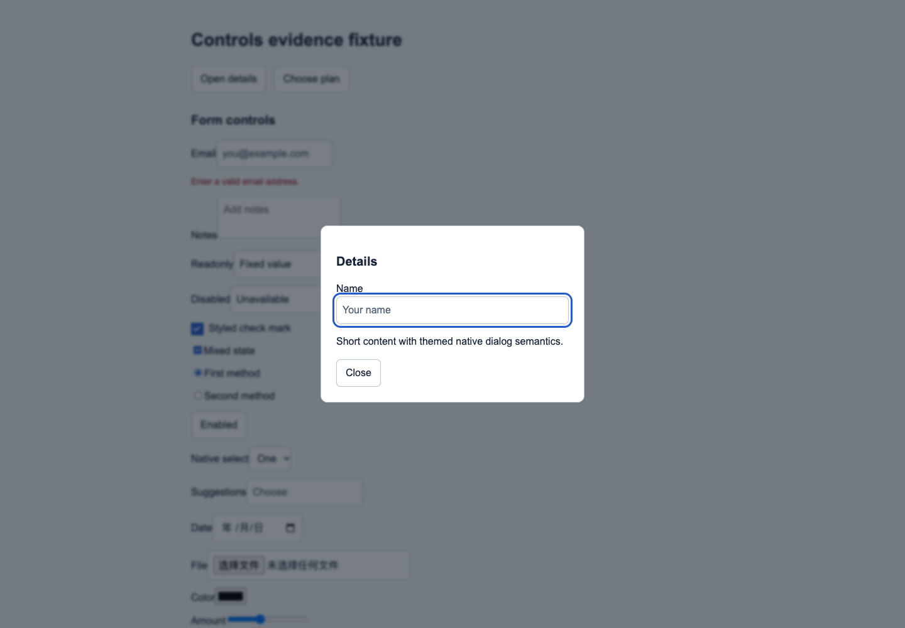
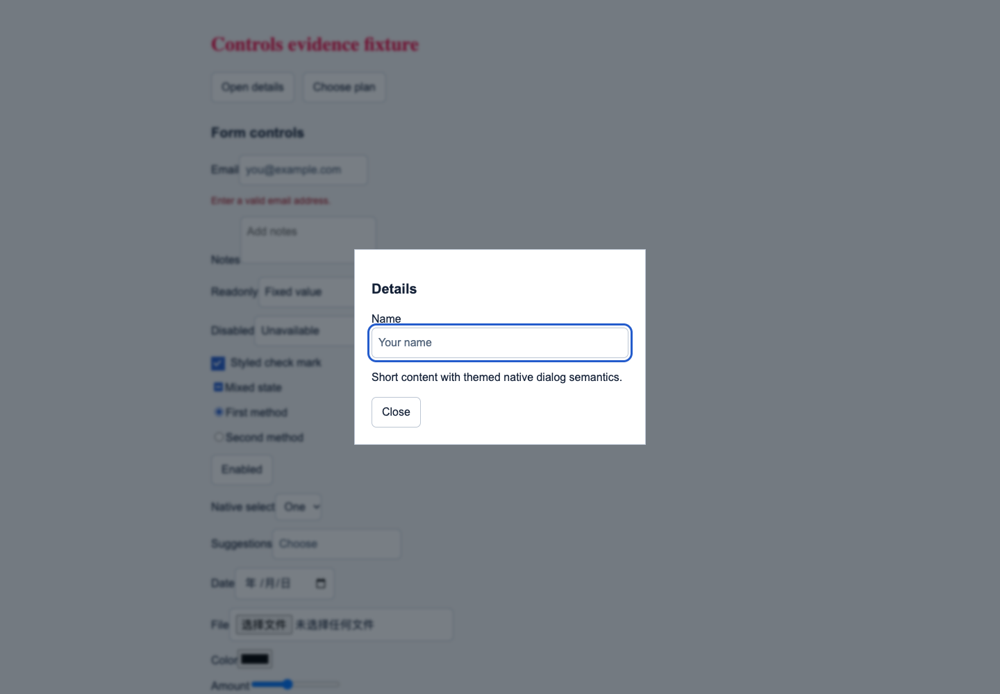

**English** · [简体中文](README.zh-CN.md)

# DesignLens

Capture the design. Keep the evidence. Check the implementation.

A **Codex skill** that turns a website into a validated design-system package—and checks whether a frontend actually follows it. Extract colors, typography, components and interaction states, then carry them into implementation with traceable references.

**[Install](#install)** · [Extract](#extract-a-design-system) · [Audit](#audit-a-frontend) · [Full guide](GUIDE.md)

The display name is **DesignLens**. Invoke **`$website-design-package`** as before; repository URLs and the skill identifier are unchanged. Current version: **2.3.0**.

## See the difference

<table>
<tr>
<td width="50%"></td>
<td width="50%"></td>
</tr>
<tr>
<td align="center"><strong>Reference styles applied</strong></td>
<td align="center"><strong>Intentional design drift</strong></td>
</tr>
</table>

Actual captures from the local v2.3 test fixture. Across desktop/mobile, the matching frontend passed **24 mapped checks**; the modified one produced **10 mismatches**, including color, font and corner-radius differences. This is measured coverage, not an overall fidelity percentage. [Report](docs/fidelity-v2.3.md) · [Image sources](docs/media/SOURCES.md).

## Why use it

- **Evidence, not guessed tokens.** Desktop/mobile captures, computed styles, rendered fonts and element/state mappings support the specification.
- **One source, four outputs.** Edit `design.md`; generate the tokens and CSS from the same parse, then verify and package them.
- **More than colors.** Track 19 control families, including dialog/dropdown open states, hover, focus and native-platform boundaries.
- **Check the actual frontend.** Audit painted styles and used fonts against the reference; importing the right variables alone does not count.
- **Portable delivery.** A four-file ZIP, ordinary CSS variables and Tailwind CSS v4 theme directives, with evidence kept separately.

## Install

```sh
git clone https://github.com/wander521/website-design-package-skill.git \
  "$HOME/.codex/skills/website-design-package"
```

Use the corresponding skills directory if `CODEX_HOME` is customized. Requires **Node.js 22+**, **Playwright** and Chromium or installed Chrome. For a standalone checkout:

```sh
npm ci
npx playwright install chromium
```

The parser/exporter is vendored. No extra project-specific AI API key is needed: **Codex interprets evidence and writes the specification; the scripts capture, compile and verify it.**

## Extract a design system

```text
Use $website-design-package to extract https://linear.app/.
Create a design specification and validated ZIP; inspect desktop/mobile,
component states, and disclose anything that could not be observed.
```

| ZIP file | Purpose |
| --- | --- |
| `design.md` | Human-readable design specification; the single source |
| `token.json` | RICOUI-compatible, DTCG-style tokens and component coverage |
| `variables.css` | Ordinary CSS custom properties |
| `theme.css` | Tailwind CSS v4 `@theme` directives and aliases |

```text
Website → browser evidence → design.md → compile → browser verify → ZIP
```

The ZIP contains exactly these four files. Fonts are named, not bundled; captures, HTML and working evidence remain outside it.

## Audit a frontend

```text
Use $website-design-package to audit http://localhost:3000 against ./design.md.
Inspect desktop/mobile and dialog/dropdown states. Report expected vs actual
values, evidence and prioritized fixes.
```

Output: **`audit.md`**, **`fidelity.json` / `fidelity.md`** and screenshots. To judge reconstruction of a specific page, also supply the original site or matching screenshots. Unknown reference rules remain unknown; an audit does not authorize redesign.

## Verify and go deeper

```sh
npm test  # 51 local-fixture tests: compiler, evidence, browser, controls, fidelity
```

| Documentation | What you will find |
| --- | --- |
| [Full guide](GUIDE.md) · [中文](GUIDE.zh-CN.md) | Runtime options, CLI pipeline, audit exit codes and troubleshooting boundaries |
| [Skill workflow](SKILL.md) | Instructions followed by Codex |
| [Format](references/format.md) · [Controls](references/controls.md) · [Fidelity](references/fidelity.md) | Contracts and measurement scope |
| [Validation history](docs/validation-v2.1.md) · [Changelog](CHANGELOG.md) | Recorded real-site evaluations and version history |

Captures are bounded snapshots, not a complete brand inventory. CSS verification does not prove semantic accuracy; visual review is required. `token.json` is DTCG-style, not strict standards compliance, and generated CSS tokens are not implemented UI components.

## Credits

[Apache-2.0](LICENSE). Built on [RICOUI DESIGN](https://github.com/ricocc/ricoui-design-md), pinned to `570aef6`; marked 18.0.3 retains MIT terms. [Provenance](references/upstream.md) · [Notices](NOTICE). Source-site content remains with its owners; the included screenshots use the project's local synthetic fixture, not third-party brand captures.
